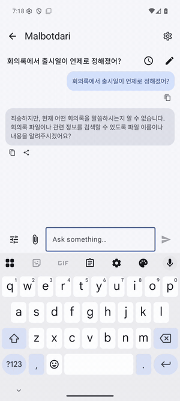

# 말벗다리 (Malbotdari)

[English](README.md)

Android용 온디바이스 채팅 비서입니다. 계정도 인터넷도 필요 없고, 아무것도 폰 밖으로 나가지 않습니다. **말벗**은 이야기 상대, **다리**는 앱과 앱을 잇는 다리입니다. *My Assistant, Local, Bridging Other Tools · Dialog Across Records & Indexes.*

<p>

</p>

*비서가 눈소리로 내 파일을 검색하고 그 내용으로 답합니다. 모두 폰 안에서.*

| 역할 | 앱 | 하는 일 |
|---|---|---|
| 채팅 | **말벗다리** (이 레포) | 대화, 예약 작업, 승인 카드 |
| AI 모델 | [온돌샘](https://github.com/sonanjip/ondolsaem) (필수) | 채팅 모델(Gemma 4, Qwen2.5)을 폰에서 받고 실행 |
| 내 파일 | [눈소리](https://github.com/sonanjip/nunsori) (선택) | 사진·문서·음성·영상을 인덱싱하고, 비서는 눈소리를 통해 검색하고 읽음 |
| 내 노트 | [조각보](https://github.com/sonanjip/jogakbo) (선택) | 메모, 저장한 웹페이지·영상, 녹음과 그 요약. 비서는 조각보를 통해 검색하고 읽음 |

## 기능

| 기능 | 하는 일 |
|---|---|
| 채팅 | 고정 가능한 채팅별 기록, 복사·공유되는 마크다운 답변, 내 지침, 로컬 문서·오디오·이미지 첨부 |
| 내 파일 (눈소리 연결 시) | 인덱싱된 파일 검색·읽기, 답변 아래 파일 미리보기, 눈소리에서 지은 인물 이름, 눈소리 검색의 "채팅으로 묻기" |
| 내 노트 (조각보 연결 시) | 노트와 요약 검색·읽기(`search_notes`, `read_note`), 찾은 노트를 누르면 조각보에서 열림 |
| 승인하는 카드 | 일정·연락처(시스템 앱이 채워진 채 열림), 파일 이동·휴지통(눈소리가 실행) |
| 예약 작업 | 나중에, 반복해서, 또는 눈소리가 맞는 파일을 인덱싱했을 때 실행하고 채팅과 알림으로 결과 전달. 새 파일은 유사도로, 또는 설정에서 고르면 온돌샘의 판단 모델(글이 있는 파일마다 예·아니오)로 매칭 |
| 프라이버시 | `INTERNET` 권한 없음, 동반 앱과는 Android 기기 내 IPC로만 통신 |

영어/한국어 UI, 다크 모드.

## 요구 사항

Android 10 이상(minSdk 29), 채팅 모델을 받은 온돌샘, 파일 기능에는 눈소리 0.10.0 이상, 노트에는 조각보 0.1.0 이상.

## 빌드

```sh
source scripts/env.sh
./gradlew assembleDebug        # app/build/outputs/apk/debug/app-debug.apk
```

SDK는 JitPack에서 받습니다. 형제 폴더 체크아웃으로 빌드하는 방법은 [docs/development.md](docs/development.md).

## 문서

[사용 안내](docs/user-guide.md) · [채팅](docs/chat.md) · [구조](docs/architecture.md) · [프라이버시](docs/privacy.md) · [개발](docs/development.md) · [로드맵](docs/roadmap.md)

## 이름의 뜻

**말벗다리**는 이야기 상대인 **말벗**과 앱과 앱을 잇는 **다리**를 합친 이름입니다. 이 앱은 둘 다입니다. 대화를 나누는 비서이면서, 다른 앱(눈소리의 파일, 조각보의 노트, 온돌샘의 모델)으로 건너가 그 내용으로 답하는 다리입니다. 원래 말벗과 다리는 따로 나온 후보였는데, 다른 이름과 겹치지 않도록 둘을 합쳤습니다. 영문 표기는 표준 로마자 표기(Malbeotdari) 대신 **Malbotdari**로 했습니다. 영어로 읽기 쉽고, *bot*이 들어가 채팅 앱이라는 점이 드러납니다.

두 부분에 각각 역두문자가 있습니다: **MALBOT**은 My Assistant, Local, Bridging Other Tools, **DARI**는 Dialog Across Records & Indexes입니다.

## 라이선스

Apache License 2.0, [LICENSE](LICENSE)와 [THIRD_PARTY_NOTICES.md](THIRD_PARTY_NOTICES.md) 참고.

눈소리 파일과 조각보 메모를 채팅에 첨부할 수 있습니다. 모델은 첨부 안에서 필요한 구간을 검색하고, 이미지는 `view_image`로 요청해 봅니다(이미지 지원 모델 필요, 질문당 두 장).

Android의 텍스트 선택 메뉴와 공유 메뉴에서 텍스트 또는 이미지 최대 10개를 채팅 초안으로 열 수 있습니다.

채팅에서 공유하거나 선택한 텍스트, PDF, 오피스 문서, 이미지(OCR), 오디오(음성 인식)를 기기에서 처리하고 검색할 수 있습니다. 온돌샘 모델이 필요하며 실패한 첨부는 다시 시도할 수 있습니다.

로컬 첨부 파일은 자동으로 처리되며, 처리가 끝나거나 실패가 해결될 때까지 전송을 기다립니다.
