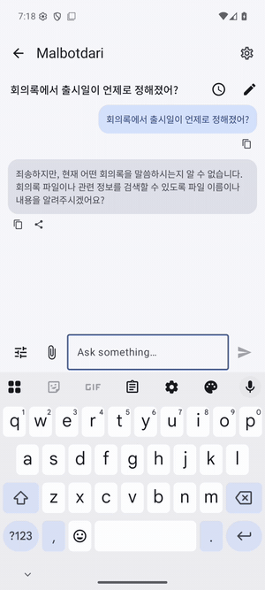

# Malbotdari (말벗다리)

[한국어](README.ko.md)

An on-device chat assistant for Android: no account, no internet, nothing leaves the phone. **말벗** is someone to talk to, **다리** a bridge: the assistant bridges your apps. *My Assistant, Local, Bridging Other Tools · Dialog Across Records & Indexes.*

<p>

</p>

*The assistant searches your files through Nunsori and answers from them, on the phone.*

| Part | App | What it does |
|---|---|---|
| Chat | **Malbotdari** (this repository) | Conversations, scheduled tasks, approval cards |
| AI model | [OndolSaem](https://github.com/sonanjip/ondolsaem) (required) | Downloads and runs the chat model (Gemma 4, Qwen2.5) on the phone |
| Your files | [Nunsori](https://github.com/sonanjip/nunsori) (optional) | Indexes photos, documents, audio and video; the assistant searches and reads them through it |
| Your notes | [Jogakbo](https://github.com/sonanjip/jogakbo) (optional) | Memos, saved web pages and videos, recordings with summaries; the assistant searches and reads them through it |

## Features

| Feature | What it does |
|---|---|
| Chat | Per-chat history with pinning, Markdown answers with copy and share, your own instructions, attached photos for vision models |
| Your files (with Nunsori) | Search and read indexed files, file previews under answers, people by the names you gave in Nunsori, "Ask in chat" from Nunsori's search |
| Your notes (with Jogakbo) | Search and read notes and their summaries (`search_notes`, `read_note`); a tap on a found note opens it in Jogakbo |
| Cards you approve | Calendar events and contacts (the system app opens prefilled), moving or trashing files (done by Nunsori) |
| Scheduled tasks | Later, repeatedly or when Nunsori indexes a matching file; results posted to the chat and notified. New files are matched by similarity or, if chosen in Settings, by OndolSaem's decision model (yes/no per file with text) |
| Privacy | No `INTERNET` permission; the companion apps are reached over Android's on-device IPC |

English and Korean UI, dark mode.

## Requirements

Android 10 or newer (minSdk 29), OndolSaem with a chat model downloaded, Nunsori 0.10.0 or newer for file features, Jogakbo 0.1.0 or newer for notes.

## Build

```sh
source scripts/env.sh
./gradlew assembleDebug        # app/build/outputs/apk/debug/app-debug.apk
```

The SDKs come from JitPack; to build against sibling checkouts see [docs/development.md](docs/development.md).

## Docs

[User guide](docs/user-guide.md) · [Chat](docs/chat.md) · [Architecture](docs/architecture.md) · [Privacy](docs/privacy.md) · [Development](docs/development.md) · [Roadmap](docs/roadmap.md)

## License

Apache License 2.0, see [LICENSE](LICENSE) and [THIRD_PARTY_NOTICES.md](THIRD_PARTY_NOTICES.md).
